

<picture><source media="(max-width: 600px)" srcset="assets/monarch/hero-mobile.svg" />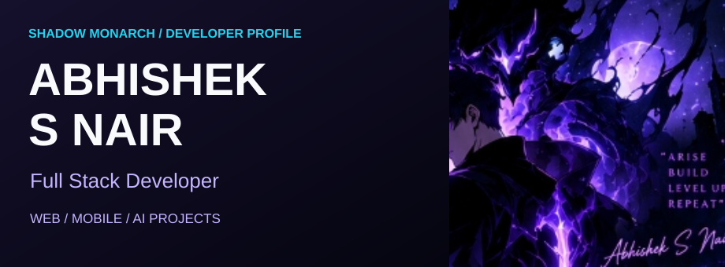</picture>

**Full Stack Developer · Web, mobile and AI projects**

[Projects](#featured-projects) · [Technology](#technology) · [Activity](#github-activity) · [Connect](#connect) · [Animated version](README.md)

### The shadow companions

Sung Jinwoo · Victory groove · Shadow soldier

### About & project focus

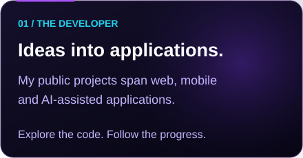
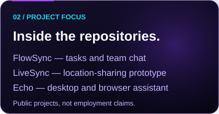

My public repositories explore team collaboration, location interfaces and AI-assisted tools. Browse [FlowSync](https://github.com/abhisheksureshnair/flowsync), [LiveSync](https://github.com/abhisheksureshnair/LiveSync) and [Echo](https://github.com/abhisheksureshnair/echo-desktop-ai) for their current implementation and setup.

### Technology

<picture><source media="(max-width: 600px)" srcset="assets/monarch/skills-mobile.svg" />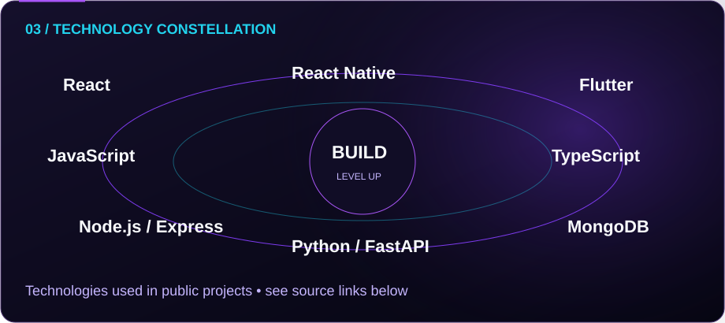</picture>

[React, Node.js, Express & MongoDB — FlowSync](https://github.com/abhisheksureshnair/flowsync) · [React Native — LiveSync](https://github.com/abhisheksureshnair/LiveSync) · [Python, FastAPI & Flutter — AlphaPulse](https://github.com/abhisheksureshnair/AlphaPulse-Stock-AI) · [TypeScript — Portfolio](https://github.com/abhisheksureshnair/abhishek-portfolio)

### Featured projects

Public code, with descriptions based on each repository. These are project examples, not claims of commercial deployment.

<a href="https://github.com/abhisheksureshnair/flowsync">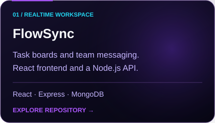</a>
<a href="https://github.com/abhisheksureshnair/LiveSync">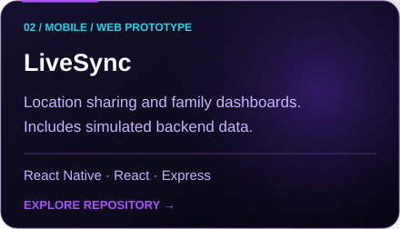</a>
<a href="https://github.com/abhisheksureshnair/AlphaPulse-Stock-AI">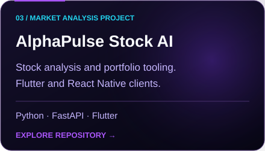</a>

<a href="https://github.com/abhisheksureshnair/abhishek-portfolio">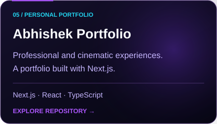</a>
<a href="https://github.com/abhisheksureshnair/ecommerce-app-flutter">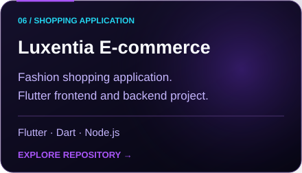</a>
<a href="https://github.com/abhisheksureshnair/vehicle-tracking-app-flutter">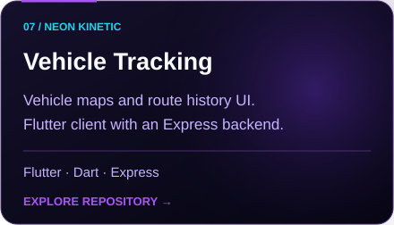</a>

### GitHub activity

<a href="https://github.com/abhisheksureshnair?tab=repositories"><picture><source media="(max-width: 600px)" srcset="assets/monarch/activity-mobile.svg" />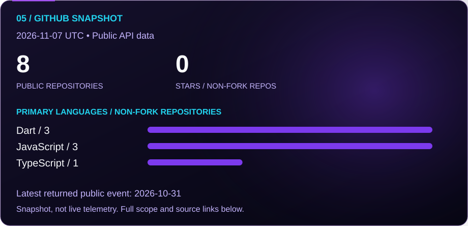</picture></a>

[Read the snapshot and methodology](docs/activity.md) · [Contribution history on GitHub](https://github.com/abhisheksureshnair?tab=overview)

The dashboard is a dated API snapshot, refreshed by a daily workflow when available. Language counts describe repositories' primary languages, not proficiency or lines of code. Contribution totals and streaks are omitted.

### Connect

<a href="mailto:nairsabhishek@gmail.com">nairsabhishek@gmail.com</a>

[Profile sources & maintenance](docs/PROFILE.md)

