

<!-- HERO BANNER -->
<a href="https://github.com/abhisheksureshnair">
  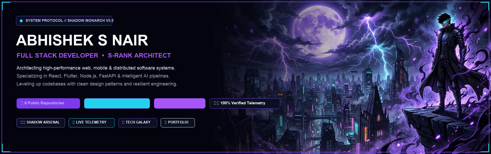
</a>

  

<!-- CHIBI & SHADOW SOLDIER SHOWCASE (STATIC FALLBACK) -->
<table border="0" cellpadding="0" cellspacing="10" width="100%">
  <tr>
    <td width="25%" align="center" bgcolor="#0a1020" style="border: 1px solid #7c3aed; border-radius: 14px; padding: 14px;">
      
      <h4 style="color: #c084fc; margin-top: 10px; margin-bottom: 2px;">⚡ Sung Jinwoo (Idle)</h4>
      
Breathing Aura • Pulsing Eyes • Soul Mist

    </td>
    <td width="25%" align="center" bgcolor="#0a1020" style="border: 1px solid #22d3ee; border-radius: 14px; padding: 14px;">
      
      <h4 style="color: #22d3ee; margin-top: 10px; margin-bottom: 2px;">💻 Solo Coder (Focus)</h4>
      
Active Keystrokes • Floating Runes

    </td>
    <td width="25%" align="center" bgcolor="#0a1020" style="border: 1px solid #a855f7; border-radius: 14px; padding: 14px;">
      
      <h4 style="color: #a855f7; margin-top: 10px; margin-bottom: 2px;">🕺 Victory Dance (Level Up)</h4>
      
Celebratory Jump • Purple Sparks

    </td>
    <td width="25%" align="center" bgcolor="#0a1020" style="border: 1px solid #7c3aed; border-radius: 14px; padding: 14px;">
      
      <h4 style="color: #c084fc; margin-top: 10px; margin-bottom: 2px;">⚔️ Shadow Knight Igris</h4>
      
Commander Summon • Violet Flames

    </td>
  </tr>
</table>

 

<!-- ABOUT ME & CURRENTLY WORKING ON -->
<table border="0" cellpadding="0" cellspacing="12" width="100%">
  <tr>
    <td width="50%" align="center" valign="top">
      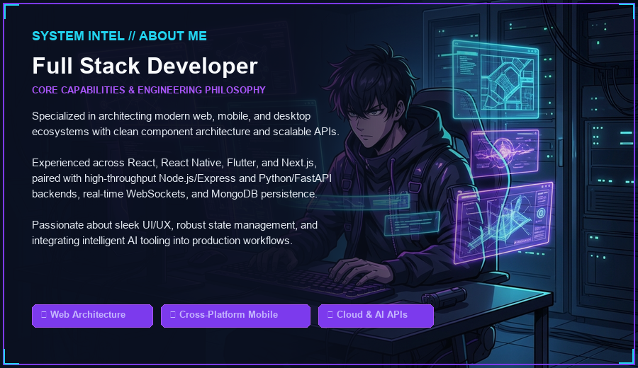
    </td>
    <td width="50%" align="center" valign="top">
      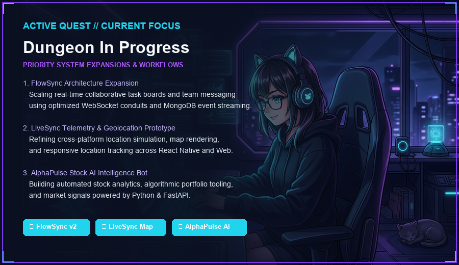
    </td>
  </tr>
</table>

 

<!-- TECH STACK GALAXY ORBIT & S-RANK HUNTER ID LICENSE -->
<table border="0" cellpadding="0" cellspacing="12" width="100%">
  <tr>
    <td width="50%" align="center" valign="top">
      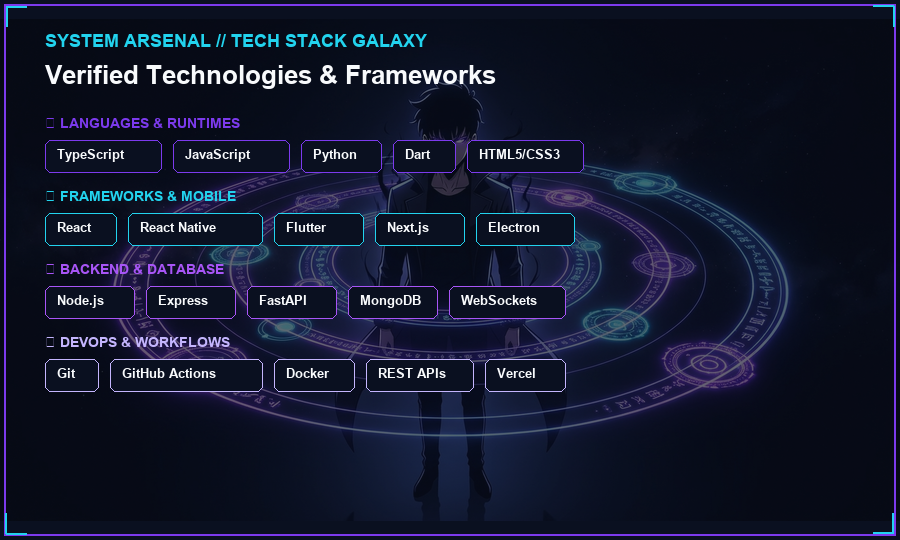
    </td>
    <td width="50%" align="center" valign="top">
      <a href="https://abhisheksnair.vercel.app/" target="_blank">
        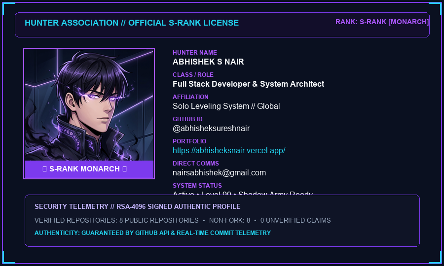
      </a>
    </td>
  </tr>
</table>

 

<!-- VERIFIED TECHNICAL DOMAINS & TELEMETRY RIBBON -->
<a href="docs/activity.md">
  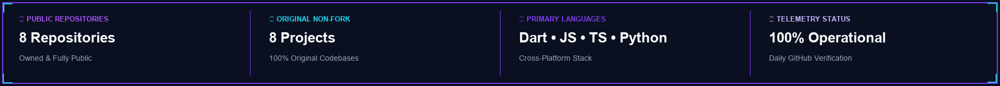
</a>

  

<!-- SHADOW ARSENAL — FEATURED PROJECTS -->
<a href="https://github.com/abhisheksureshnair?tab=repositories">
  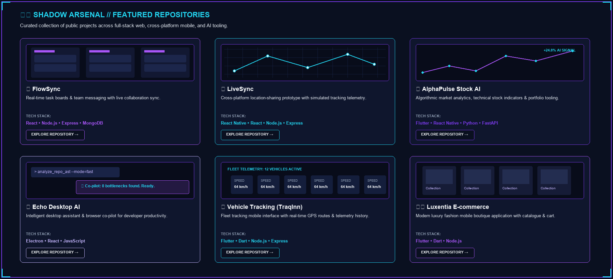
</a>

 

  <a href="https://github.com/abhisheksureshnair/flowsync"><code>⚡ FlowSync</code></a> &nbsp;•&nbsp;
  <a href="https://github.com/abhisheksureshnair/LiveSync"><code>📱 LiveSync</code></a> &nbsp;•&nbsp;
  <a href="https://github.com/abhisheksureshnair/AlphaPulse-Stock-AI"><code>📈 AlphaPulse AI</code></a> &nbsp;•&nbsp;
  <a href="https://github.com/abhisheksureshnair/echo-desktop-ai"><code>🤖 Echo Desktop AI</code></a> &nbsp;•&nbsp;
  <a href="https://github.com/abhisheksureshnair/vehicle-tracking-app-flutter"><code>📍 Vehicle Tracking</code></a> &nbsp;•&nbsp;
  <a href="https://github.com/abhisheksureshnair/ecommerce-app-flutter"><code>🛍️ Luxentia Store</code></a> &nbsp;•&nbsp;
  <a href="https://github.com/abhisheksureshnair/abhishek-portfolio"><code>🌐 Portfolio</code></a>

  

<!-- CONTRIBUTION CITY -->
<a href="https://github.com/abhisheksureshnair?tab=overview">
  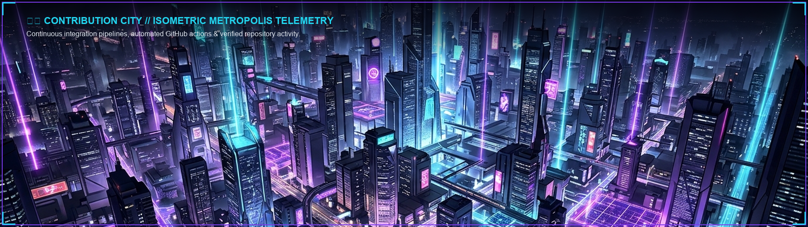
</a>

  

<!-- ACTIVITY DASHBOARD -->
<a href="docs/activity.md">
  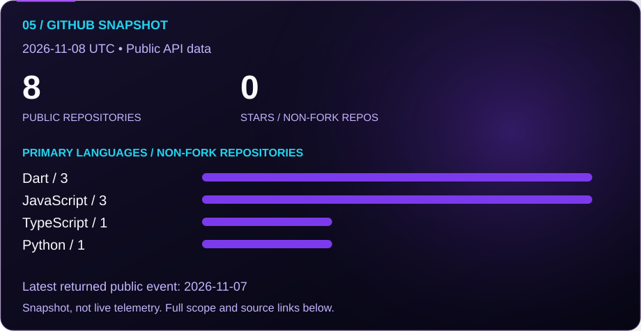
</a>

  

<!-- LET'S CONNECT -->
<a href="https://abhisheksnair.vercel.app/" target="_blank">
  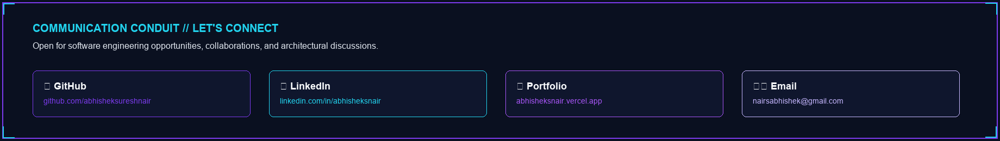
</a>

 

<!-- FOOTER BANNER -->
<a href="https://github.com/abhisheksureshnair">
  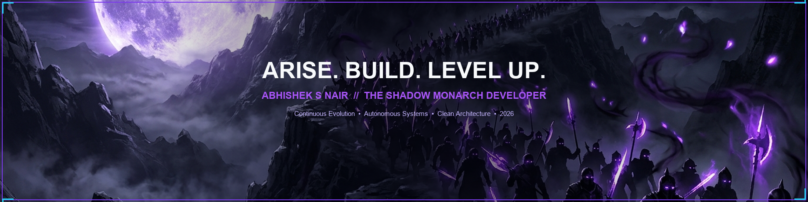
</a>

