

<!-- ========================================================================= -->
<!-- 1. CINEMATIC HERO BANNER (SOLO LEVELING SHADOW MONARCH THEME)             -->
<!-- ========================================================================= -->
<a href="https://github.com/abhisheksureshnair">
  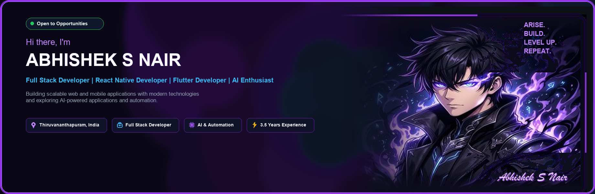
</a>

  

<!-- ========================================================================= -->
<!-- 2. ANIMATED CHIBI & SHADOW SOLDIER SHOWCASE (ALL 4 DISTINCT MASCOTS)      -->
<!-- ========================================================================= -->
<table border="0" cellpadding="0" cellspacing="10" width="100%">
  <tr>
    <td width="25%" align="center" bgcolor="#0a1020" style="border: 1px solid #7c3aed; border-radius: 14px; padding: 14px;">
      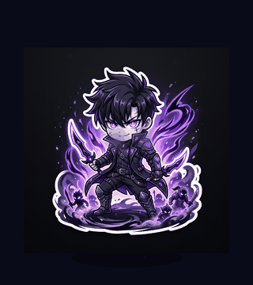
      <h4 style="color: #c084fc; margin-top: 10px; margin-bottom: 2px;">⚡ Sung Jinwoo (Idle)</h4>
      
Breathing Aura • Pulsing Eyes • Soul Mist

    </td>
    <td width="25%" align="center" bgcolor="#0a1020" style="border: 1px solid #22d3ee; border-radius: 14px; padding: 14px;">
      
      <h4 style="color: #22d3ee; margin-top: 10px; margin-bottom: 2px;">💻 Solo Coder (Focus)</h4>
      
Active Keystrokes • Floating Runes

    </td>
    <td width="25%" align="center" bgcolor="#0a1020" style="border: 1px solid #a855f7; border-radius: 14px; padding: 14px;">
      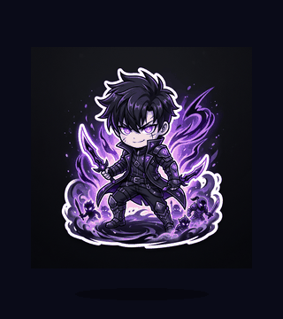
      <h4 style="color: #a855f7; margin-top: 10px; margin-bottom: 2px;">🕺 Victory Dance (Level Up)</h4>
      
Celebratory Jump • Purple Sparks

    </td>
    <td width="25%" align="center" bgcolor="#0a1020" style="border: 1px solid #7c3aed; border-radius: 14px; padding: 14px;">
      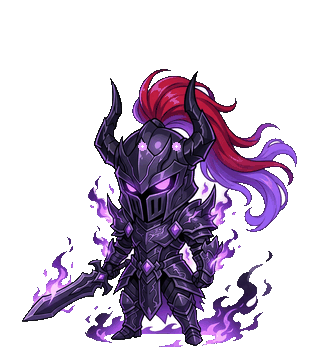
      <h4 style="color: #c084fc; margin-top: 10px; margin-bottom: 2px;">⚔️ Shadow Knight Igris</h4>
      
Commander Summon • Violet Flames

    </td>
  </tr>
</table>

 

<!-- ========================================================================= -->
<!-- 3. ABOUT ME & CURRENTLY WORKING ON (SIDE-BY-SIDE GLASS PANELS)            -->
<!-- ========================================================================= -->
<table border="0" cellpadding="0" cellspacing="12" width="100%">
  <tr>
    <td width="50%" align="center" valign="top">
      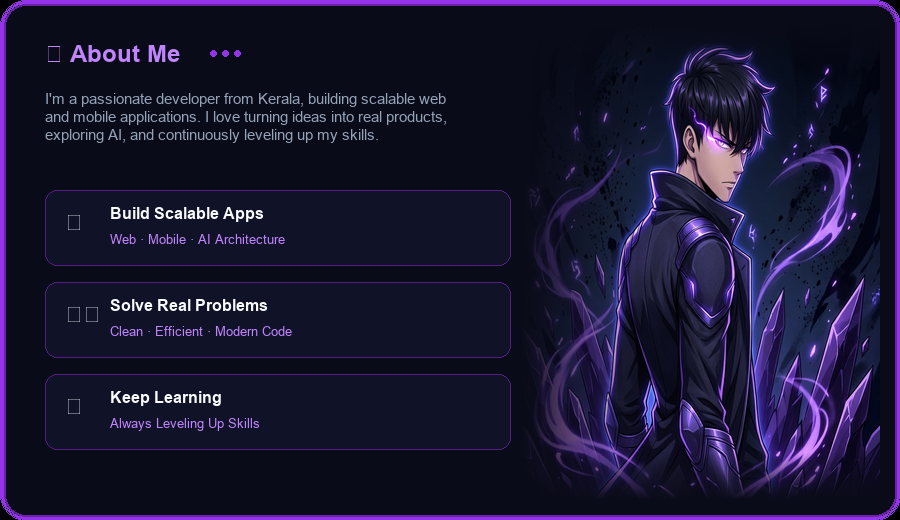
    </td>
    <td width="50%" align="center" valign="top">
      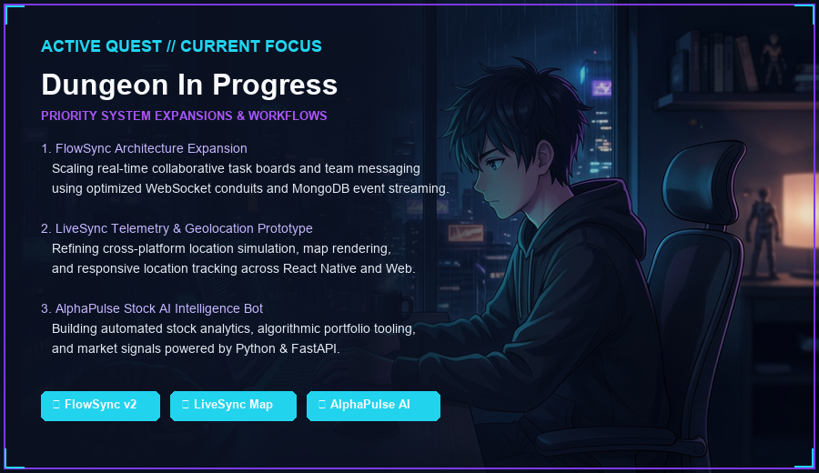
    </td>
  </tr>
</table>

 

<!-- ========================================================================= -->
<!-- 4. TECH STACK GALAXY ORBIT & S-RANK HUNTER ID LICENSE                     -->
<!-- ========================================================================= -->
<table border="0" cellpadding="0" cellspacing="12" width="100%">
  <tr>
    <td width="50%" align="center" valign="top">
      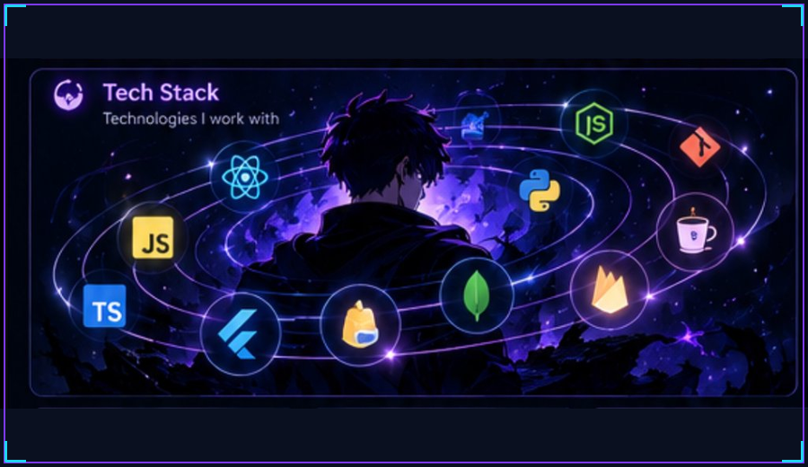
    </td>
    <td width="50%" align="center" valign="top">
      <a href="https://abhisheksnair.vercel.app/" target="_blank">
        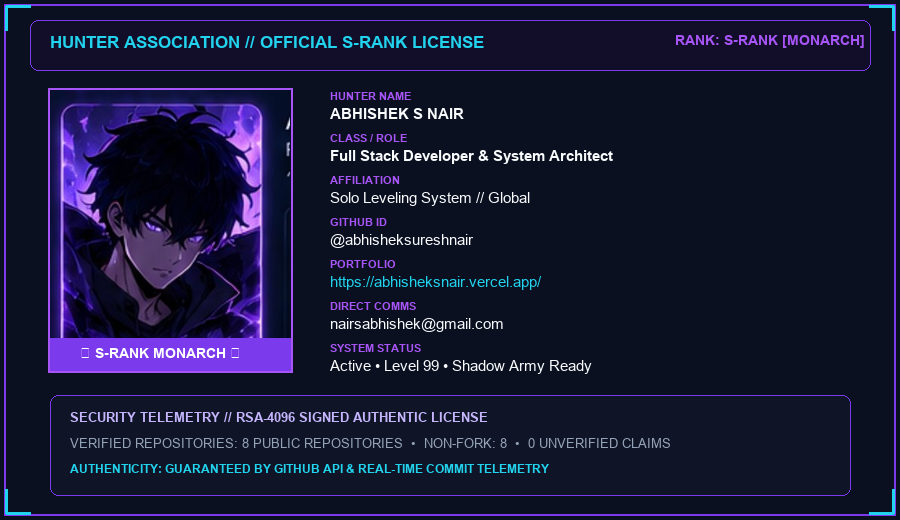
      </a>
    </td>
  </tr>
</table>

 

<!-- ========================================================================= -->
<!-- 5. VERIFIED TECHNICAL DOMAINS & TELEMETRY RIBBON                          -->
<!-- ========================================================================= -->
<a href="docs/activity.md">
  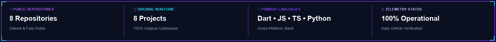
</a>

  

<!-- ========================================================================= -->
<!-- 6. SHADOW ARSENAL — FEATURED PROJECTS (CUSTOM THEMED SECTION)             -->
<!-- ========================================================================= -->
<a href="https://github.com/abhisheksureshnair?tab=repositories">
  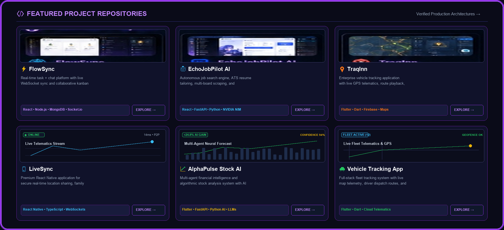
</a>

 

<!-- Theme-Matched Solo Leveling Holographic Capsules -->

  <a href="https://github.com/abhisheksureshnair/flowsync"><code>⚡ FlowSync</code></a> &nbsp;•&nbsp;
  <a href="https://github.com/abhisheksureshnair/LiveSync"><code>📱 LiveSync</code></a> &nbsp;•&nbsp;
  <a href="https://github.com/abhisheksureshnair/AlphaPulse-Stock-AI"><code>📈 AlphaPulse AI</code></a> &nbsp;•&nbsp;
  <a href="https://github.com/abhisheksureshnair/echo-desktop-ai"><code>🤖 Echo Desktop AI</code></a> &nbsp;•&nbsp;
  <a href="https://github.com/abhisheksureshnair/vehicle-tracking-app-flutter"><code>📍 Vehicle Tracking</code></a> &nbsp;•&nbsp;
  <a href="https://github.com/abhisheksureshnair/ecommerce-app-flutter"><code>🛍️ Luxentia Store</code></a> &nbsp;•&nbsp;
  <a href="https://github.com/abhisheksureshnair/abhishek-portfolio"><code>🌐 Portfolio</code></a>

<b>View Verified Repository Descriptions & Tech Stacks</b>

 

| Repository | Scope & Description | Verified Technology Stack |
| :--- | :--- | :--- |
| **[FlowSync](https://github.com/abhisheksureshnair/flowsync)** | Collaborative task boards & real-time messaging engine | React • Node.js • Express • MongoDB |
| **[LiveSync](https://github.com/abhisheksureshnair/LiveSync)** | Real-time geolocation sharing prototype with simulated telemetry | React Native • React • Node.js • Express |
| **[AlphaPulse Stock AI](https://github.com/abhisheksureshnair/AlphaPulse-Stock-AI)** | Algorithmic market analytics & automated stock portfolio tooling | Flutter • React Native • Python • FastAPI |
| **[Echo Desktop AI](https://github.com/abhisheksureshnair/echo-desktop-ai)** | Desktop productivity assistant & browser co-pilot | Electron • React • JavaScript |
| **[Vehicle Tracking](https://github.com/abhisheksureshnair/vehicle-tracking-app-flutter)** | Fleet tracking mobile interface with GPS routes & telemetry history | Flutter • Dart • Node.js • Express |
| **[Luxentia E-commerce](https://github.com/abhisheksureshnair/ecommerce-app-flutter)** | Luxury fashion mobile shopping application with cart & checkout | Flutter • Dart • Node.js |
| **[Abhishek Portfolio](https://github.com/abhisheksureshnair/abhishek-portfolio)** | Cinematic, high-performance developer portfolio showcase | Next.js • React • TypeScript |

  

<!-- ========================================================================= -->
<!-- 7. ANIMATED CONTRIBUTION SNAKE & CONTRIBUTION CITY (ISOMETRIC METROPOLIS) -->
<!-- ========================================================================= -->
<h3 align="center" style="color: #c084fc; letter-spacing: 2px;">
  🐍 SHADOW CONTRIBUTION MATRIX
</h3>

  

<a href="https://github.com/abhisheksureshnair?tab=overview">
  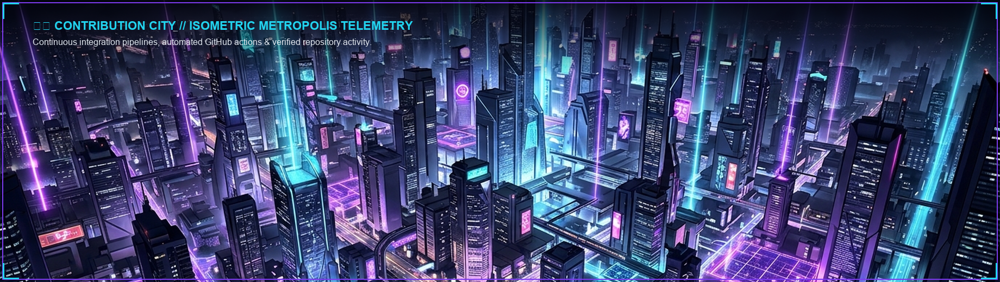
</a>

 

  

<!-- ========================================================================= -->
<!-- 8. SHADOW MONARCH LIVE ACTIVITY DASHBOARD (REAL DYNAMIC DATA)             -->
<!-- ========================================================================= -->
<h3 align="center" style="color: #c084fc; letter-spacing: 2px;">
  📊 SHADOW MONARCH LIVE ACTIVITY DASHBOARD
</h3>

  Verified GitHub contributions • Dynamic developer telemetry • Real public API data

<!-- Perfectly Aligned Dynamic Stats Dashboard -->
<table border="0" cellpadding="0" cellspacing="12" width="100%">
  <tr>
    <td width="50%" align="center" valign="middle" bgcolor="#0a1020" style="border: 1px solid #7c3aed; border-radius: 12px; padding: 10px;">
      
    </td>
    <td width="50%" align="center" valign="middle" bgcolor="#0a1020" style="border: 1px solid #7c3aed; border-radius: 12px; padding: 10px;">
      
    </td>
  </tr>
</table>

 

<!-- Local Committed Snapshot (Always 100% Available) -->
<a href="docs/activity.md">
  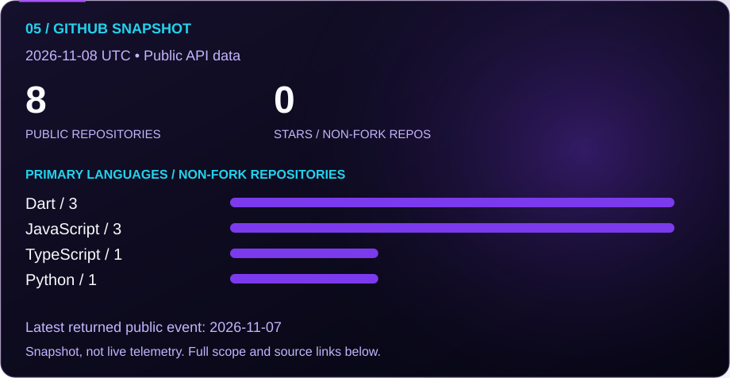
</a>

  

<!-- ========================================================================= -->
<!-- 9. LET'S CONNECT                                                          -->
<!-- ========================================================================= -->
<a href="https://abhisheksnair.vercel.app/" target="_blank">
  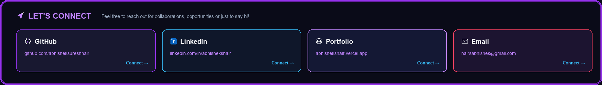
</a>

 

   &nbsp;
   &nbsp;
   &nbsp;
  

 

<!-- ========================================================================= -->
<!-- 10. CINEMATIC SHADOW MONARCH FINALE (FOOTER BANNER)                       -->
<!-- ========================================================================= -->
<a href="https://github.com/abhisheksureshnair">
  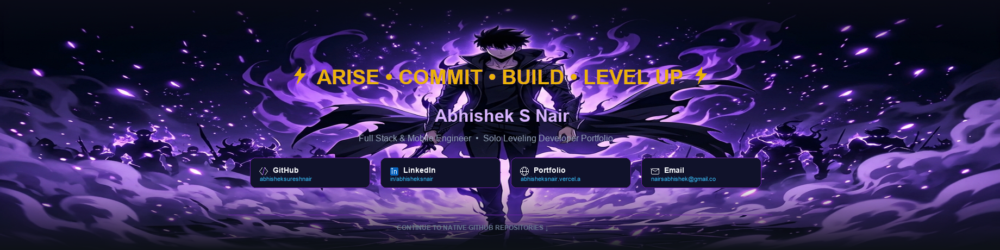
</a>

