

<picture><source media="(max-width: 600px) and (prefers-reduced-motion: reduce)" srcset="assets/hero/shadow-monarch-mobile-static.svg" /><source media="(max-width: 600px)" srcset="assets/hero/shadow-monarch-mobile.svg" /><source media="(prefers-reduced-motion: reduce)" srcset="assets/hero/shadow-monarch-static.svg" /></picture>

<picture><source media="(prefers-reduced-motion: reduce)" srcset="assets/monarch/chibi-idle.png" />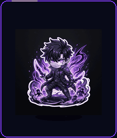</picture>
<picture><source media="(prefers-reduced-motion: reduce)" srcset="assets/monarch/chibi-dancing.png" />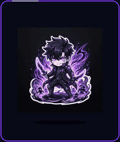</picture>
<picture><source media="(prefers-reduced-motion: reduce)" srcset="assets/monarch/shadow-soldier.png" />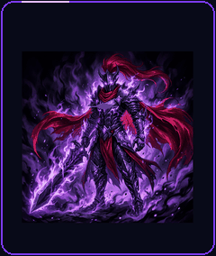</picture>

<picture><source media="(prefers-reduced-motion: reduce)" srcset="assets/cards/about-static.svg" /></picture>
<picture><source media="(prefers-reduced-motion: reduce)" srcset="assets/cards/project-focus-static.svg" /></picture>

<picture><source media="(prefers-reduced-motion: reduce)" srcset="assets/cards/tech-galaxy-static.svg" /></picture>
<a href="https://abhisheksnair.vercel.app/"><picture><source media="(prefers-reduced-motion: reduce)" srcset="assets/cards/hunter-id-static.svg" /></picture></a>

<a href="docs/activity.md">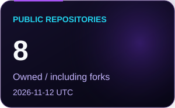</a>
<a href="docs/activity.md">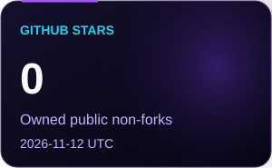</a>
<a href="docs/activity.md">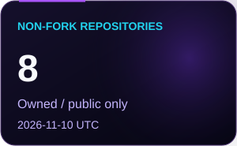</a>

<picture><source media="(max-width: 600px)" srcset="assets/cards/heading-projects-mobile.svg" /></picture>

<a href="https://github.com/abhisheksureshnair/flowsync">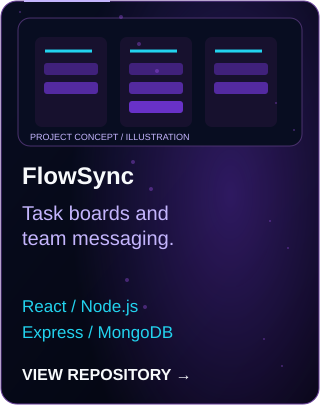</a>
<a href="https://github.com/abhisheksureshnair/LiveSync">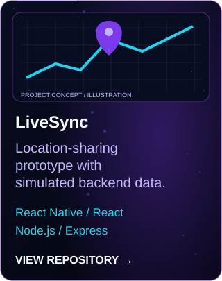</a>
<a href="https://github.com/abhisheksureshnair/AlphaPulse-Stock-AI">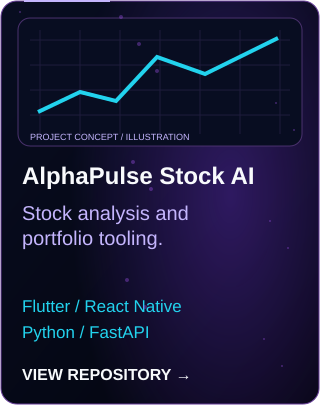</a>
<a href="https://github.com/abhisheksureshnair/echo-desktop-ai">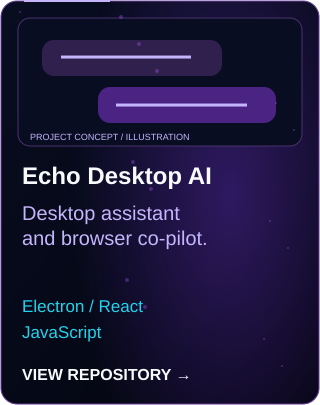</a>
<a href="https://github.com/abhisheksureshnair/ecommerce-app-flutter">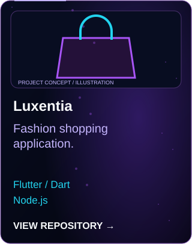</a>
<a href="https://github.com/abhisheksureshnair/vehicle-tracking-app-flutter">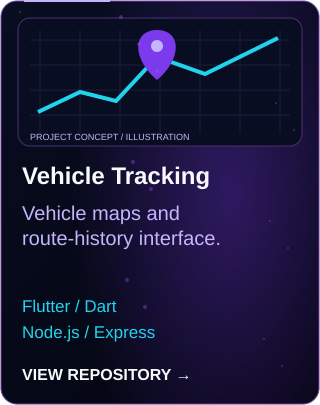</a>
<a href="https://github.com/abhisheksureshnair/abhishek-portfolio">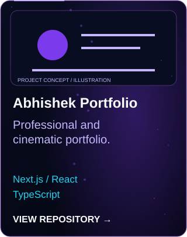</a>

Project descriptions and technology sources

- **[FlowSync](https://github.com/abhisheksureshnair/flowsync)** — Task boards and team messaging. React / Node.js; Express / MongoDB.
- **[LiveSync](https://github.com/abhisheksureshnair/LiveSync)** — Location-sharing prototype with simulated backend data. React Native / React; Node.js / Express.
- **[AlphaPulse Stock AI](https://github.com/abhisheksureshnair/AlphaPulse-Stock-AI)** — Stock analysis and portfolio tooling. Flutter / React Native; Python / FastAPI.
- **[Echo Desktop AI](https://github.com/abhisheksureshnair/echo-desktop-ai)** — Desktop assistant and browser co-pilot. Electron / React; JavaScript.
- **[Luxentia](https://github.com/abhisheksureshnair/ecommerce-app-flutter)** — Fashion shopping application. Flutter / Dart; Node.js.
- **[Vehicle Tracking](https://github.com/abhisheksureshnair/vehicle-tracking-app-flutter)** — Vehicle maps and route-history interface. Flutter / Dart; Node.js / Express.
- **[Abhishek Portfolio](https://github.com/abhisheksureshnair/abhishek-portfolio)** — Professional and cinematic portfolio. Next.js / React; TypeScript.

These are public project examples, not employment or commercial deployment claims. Project Focus describes repository contents rather than an assertion of current work.

<picture><source media="(max-width: 600px)" srcset="assets/cards/heading-activity-mobile.svg" /></picture>

<a href="docs/activity.md"><picture><source media="(max-width: 600px)" srcset="assets/stats/activity-mobile.svg" /></picture></a>

<a href="https://github.com/abhisheksureshnair?tab=overview"><picture><source media="(prefers-reduced-motion: reduce)" srcset="assets/background/contribution-city-static.svg" /></picture></a>

Statistics scope and update policy

[Read the dated API snapshot](docs/activity.md). Languages count non-fork repositories by primary language, not lines of code or proficiency. A daily workflow checks public data and publishes only when values change. The timestamp identifies the last changed snapshot; failures retain it. Contribution totals and streaks are omitted.

<picture><source media="(max-width: 600px)" srcset="assets/cards/heading-connect-mobile.svg" /></picture>

<picture><source media="(prefers-reduced-motion: reduce)" srcset="assets/footer/shadow-energy-static.svg" /></picture>

Profile sources, accessibility and maintenance

[Source audit](docs/PROFILE.md) · [Static version](README-static.md) · [Validation](docs/QA.md) · [Artwork provenance](docs/ARTWORK.md)

Email: [nairsabhishek@gmail.com](mailto:nairsabhishek@gmail.com). Title and contacts come from the existing public account and portfolio. No resume-dependent experience, education, location or availability claims are included.

